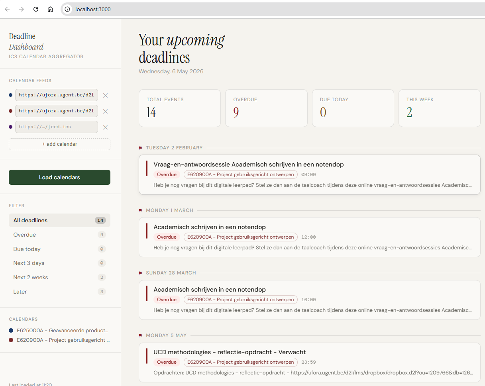

# IO Deadline Dashboard
Dashboard for deadlines of io courses based on Ufora ICS calendar feeds.

Fetches, parses and combines ICS calendar feeds into a deadline overview.

🌐 Live: https://industrialdesign.ugent.be/deadlines/



## Running it locally

```bash
npm install
npm start
```

Then open **http://localhost:3000**. `server.js` only serves the page here; the data still comes
from the live Supabase function (it accepts requests from `localhost`), so changes you make
locally (votes, start dates) are real.

## Usage

1. Add one or more `.ics` calendar feed URLs in the sidebar (Ufora, Google Calendar, Outlook, etc.)
2. Click **Load calendars**
3. Your URLs are saved in your browser, so they persist between visits (they're never stored on the server, since feed URLs contain personal tokens)

### Programme-year presets

Fixed calendar sets (1IO – 4IO) are defined in `presets.yaml` and appear as buttons in the sidebar.
Clicking one loads its feeds; editing the list switches back to **Custom**. You can link directly to a set with `?set=2IO`.

```yaml
1IO:
  - https://ufora.ugent.be/d2l/le/calendar/feed/user/feed.ics?feedOU=...&token=...
  - https://ufora.ugent.be/d2l/le/calendar/feed/user/feed.ics?feedOU=...&token=...
2IO:
  - https://...
```

#### Adding or changing feed URLs

1. In Ufora, open the course → *Calendar* → *Subscribe*, and copy the feed URL (it contains the course's `feedOU=` number).
2. Add it to `presets.yaml` under the right set, as a new `- https://…` line (indented two spaces). A URL listed twice is shown once.
3. Run `npm run deploy:fn`. The function has its own copy of `presets.yaml`, so without this step the site keeps showing the old sets. No need to copy `index.html` again.
4. Check the set, e.g. https://industrialdesign.ugent.be/deadlines/?set=1IO. The number of feeds appears when you hover over the set's button.

## Features

- Fetches ICS feeds server-side through the Supabase function (no CORS issues)
- Combines multiple calendars into one unified timeline
- Urgency grouping: overdue / today / next 3 days / next 2 weeks / later
- Color-coded per calendar
- Shows event time, description, and location when available
- Remembers your calendar URLs in your browser

### Student effort estimates

Every deadline shows hour-range buttons (<1h, 1–3h, 3–8h, 8–20h, 20h+). Before the deadline students give the time they expect it to take, afterwards the time it actually took; both averages are shown on the item. Answers are anonymous (a random id per browser), and clicking your answer again removes it.

Answers are stored in the `effort_estimates` table in Supabase.

### Start dates and the Workload view

Each deadline has a *Start date* (when work on the assignment starts; defaults to two weeks before the deadline until someone sets it). The **Workload** tab draws every assignment as a bar from its start date to its deadline, one row each, sorted by deadline. The darker the bar, the more time students spend on it (specific hours if set, otherwise the average estimate); a faint outline means no estimate yet.

Start dates are stored in the `event_start_dates` table in Supabase.

Free Supabase projects pause after a week without activity; restore them from the dashboard.

## Hosting on the UGent webshare

The webshare only serves static files and can't fetch the feeds itself, so the page talks to the
Supabase function in `supabase/functions/deadlines`.

- **After changing `presets.yaml` or the function:** `npm run deploy:fn` (needs `npx supabase login` once).
- **After changing `index.html`:** copy it to the webshare's `deadlines` folder.

Details, including what the webshare can and can't do: [docs/hosting.md](docs/hosting.md).

## Requirements

- Node.js 16+
- npm

## Changing the port

```bash
PORT=8080 npm start
```